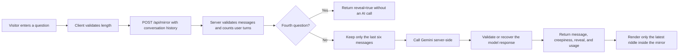

# The Black Glass

> Every question comes with a price.

**The Black Glass** is an interactive, AI-powered horror experience built with Next.js and the Google Gemini API. Visitors ask an ornate Victorian mirror questions about an imaginary future. The mirror responds with short, increasingly unsettling riddles before the fourth question triggers a full-screen cinematic jump scare.

The project was created for the Week 6 **Add a Reliable AI Feature** assignment. It demonstrates a server-controlled AI feature with secret management, input and output limits, graceful failure handling, cost awareness, and a clear separation between browser and server responsibilities.

<p align="center">
  
</p>

## Features

- Server-side Gemini integration through `POST /api/mirror`
- A system prompt stored in server code with character, format, and safety rules
- Short, dark AI-generated riddles displayed inside the mirror
- Code-controlled escalation based on the number of user turns
- A four-question experience with a server-controlled final reveal
- Conversation memory limited to the six most recent messages
- Full-screen animated jump scare using a dedicated image asset
- Sequenced horror sound effects powered by Howler
- Motion effects with a reduced-motion fallback
- Responsive desktop and mobile layouts
- Accessible labels, live regions, keyboard focus states, and readable contrast
- Server-side token usage and latency logging without logging user text or secrets

## Technology

| Layer | Technology |
| --- | --- |
| Framework | Next.js 16 App Router |
| Language | TypeScript |
| UI | React 19 |
| AI | Google Gemini API with the official `@google/genai` SDK |
| Model | Configurable through `GEMINI_MODEL`; currently `gemini-3-flash-preview` |
| Animation | Motion for React and CSS animations |
| Audio | Howler.js |
| Styling | Global responsive CSS |
| Fonts | Metal Mania and Nosifer |

## How the AI feature works



The browser never calls Gemini directly. It sends the current alternating user/model history to the Next.js route. The server validates the request, calculates the creepiness level from the number of user turns, trims history, and calls Gemini using `process.env.GEMINI_API_KEY`. The API key and system prompt never reach the client.

The fourth question is controlled entirely by application code. It skips the AI call and returns `reveal: true`, ensuring that the model cannot trigger, delay, or prevent the jump scare.

## Reliability and guardrails

### Bad input

- Questions are limited to 200 characters in both the UI and server.
- Stored model messages are limited to 1,000 characters.
- Requests containing more than 12 messages are rejected rather than silently truncated.
- An empty latest question returns a friendly HTTP 400 response.
- Invalid or oversized input never reaches Gemini.

### Bad output

- Gemini is instructed to return a structured `{ "message": string }` response.
- A response schema and JSON MIME type are supplied to the SDK.
- If JSON parsing fails, the route safely falls back to the model's plain text.
- Output is limited to 80 tokens and the prompt requests only one or two short lines.

### Failure and slow-response handling

- Gemini calls have a 10-second per-attempt timeout.
- Timeouts retry once immediately, capping a stalled request at roughly 20 seconds instead of waiting indefinitely.
- Rate-limit and quota errors retry once after a two-second delay.
- Repeated timeouts return HTTP 504 with a friendly message.
- Authentication, model, and configuration failures return a controlled HTTP 500 response.
- Failed questions are restored to the input and removed from conversation history, so they do not consume one of the four turns.

### Primary failure mode

The primary observed failure mode was **unpredictable upstream model latency**. During testing, an otherwise small third-turn request took 119 seconds even though it contained only 238 prompt tokens and 27 output tokens.

The guardrail is a server-enforced 10-second timeout with one retry. The model was also selected through measured latency testing: the previous Flash-Lite configuration took 23–27 seconds in repeated tests, while `gemini-3-flash-preview` usually completed this workload in approximately one to two seconds.

## Cost awareness

The app limits cost in several ways:

- Maximum question length: 200 characters
- Maximum stored model-message length: 1,000 characters
- Maximum request history: 12 messages
- Maximum history sent to Gemini: six messages
- Maximum generated output: 80 tokens
- Maximum AI calls per complete experience: three; the fourth question triggers the reveal without an AI call
- Minimal model thinking level

Measured requests generally used approximately **180–250 input tokens** and **21–27 output tokens**. At the current paid standard price for Gemini 3 Flash Preview—$0.50 per million input tokens and $3.00 per million output tokens—a typical request costs roughly **$0.0002**, or about **$0.0006 for a complete three-call experience**. Free-tier calls are free. Pricing can change, so confirm current rates on the [official Gemini API pricing page](https://ai.google.dev/gemini-api/docs/pricing).

## Security and privacy

- `GEMINI_API_KEY` is read only inside the server route.
- No `NEXT_PUBLIC_` secret variables are used.
- `.env.local` is ignored by Git.
- `.env.example` contains placeholders only.
- Server logs contain turn number, message count, latest-question character count, duration, and token totals.
- Logs never include the API key, request headers, user questions, or model replies.

## Getting started

### Prerequisites

- Node.js and npm
- A Google Gemini API key

### Installation

```bash
npm install
```

Create or update the Git-ignored `.env.local` file:

```dotenv
GEMINI_API_KEY=your_key_here
GEMINI_MODEL=gemini-3-flash-preview
```

Never commit `.env.local` or expose the key through a `NEXT_PUBLIC_` variable.

Start the development server:

```bash
npm run dev
```

Open [http://localhost:3000](http://localhost:3000) in a browser.

## Available scripts

| Command | Purpose |
| --- | --- |
| `npm run dev` | Start the local development server |
| `npm run lint` | Run TypeScript validation with `tsc --noEmit` |
| `npm run build` | Create and validate a production build |
| `npm run start` | Run the compiled production application |

## Project structure

```text
app/
├── api/mirror/route.ts          # Validation, escalation, Gemini call, retries, and usage logging
├── components/
│   ├── MirrorScene.tsx          # Mirror artwork and AI response presentation
│   ├── QuestionComposer.tsx     # Question form, counters, errors, and reset control
│   └── ScareOverlay.tsx         # Full-screen jump-scare sequence
├── hooks/useScareAudio.ts       # Sequenced jump-scare audio
├── globals.css                  # Theme, responsive layout, and visual effects
├── layout.tsx                   # Metadata and font configuration
└── page.tsx                     # Client conversation state and experience flow
public/
├── audio/                       # Jump-scare sound effects
└── images/                      # Mirror and reveal artwork
```

## Testing the experience

1. Ask three questions and confirm that each answer appears only inside the mirror.
2. Confirm that the counter decreases only after successful questions.
3. Enter a 200-character question and verify the client limit.
4. Trigger or simulate an API failure and confirm that the question is restored without consuming a turn.
5. Ask the fourth question and confirm that no AI answer appears before the jump scare.
6. Test with reduced motion enabled and confirm the reveal remains usable without rapid animation.
7. Run `npm run lint` and `npm run build` before committing.

## Development control and lessons

Changes were reviewed through Git diffs and verified with lint, production builds, real API timing tests, and staged secret scans. One caught implementation mistake was using the legacy `thinkingBudget: 0` option with a newer Gemini model, which caused a 400 `INVALID_ARGUMENT` response. It was removed and replaced with the supported minimal thinking-level configuration. Latency testing later exposed the 119-second provider stall, leading to the timeout and retry guardrail.

## Deployment checklist

- Push the source code to GitHub without `.env.local`.
- Configure `GEMINI_API_KEY` and `GEMINI_MODEL` in the deployment provider's server-side environment settings.
- Run `npm run build` before deployment.
- Verify `/api/mirror` from the deployed site.
- Confirm that no secret or `NEXT_PUBLIC_` key appears in the browser bundle or repository history.

## Entertainment notice

The Black Glass is a fictional horror experience for entertainment. It does not predict real events or provide health, financial, safety, or relationship advice.

## Author

**Kendra Hartnett**

Designed and developed with assistance from **OpenAI Codex**.

## Asset notes

The project uses custom supplied mirror artwork and jump-scare imagery. Horror sound effects are sourced from Mixkit. Confirm that asset licenses and attribution requirements are appropriate before redistribution or commercial use.
